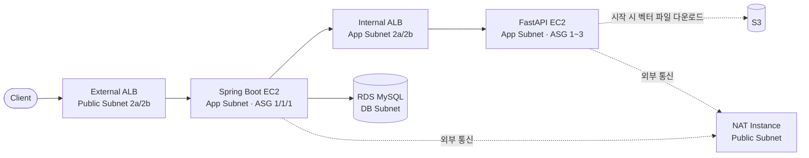

# Momantle AWS Infra

Momantle은 단일 EC2에서 운영하던 서비스를 AWS 3-Tier 구조로 재설계하고, 장애 테스트로 복구 시간을 검증하는 프로젝트입니다.
초기에는 하나의 EC2 인스턴스에서 Spring Boot, FastAPI, MySQL을 통합 운영했습니다. 이 구조에서 서버 자원 관리, 데이터베이스 운영, 네트워크 보안, 장애 대응 측면의 한계를 확인했고, 기존 인프라를 분석해 서비스별로 독립적인 운영 환경과 확장성, 안정성을 갖춘 인프라를 설계하고 구축했습니다.
인프라의 구성 과정은 docs/에, 개선 이력은 CHANGELOG에, 각 기술 선택의 근거와 트러블슈팅은 문서별로 함께 기록합니다.
| 항목 | 내용 |
| --- | --- |
| 기간 | 2026.04 ~ 진행 중 |
| 인원 | 1인 (설계, 구축, 운영) |
| 스택 | AWS (VPC, EC2, ALB, Auto Scaling, RDS, S3, IAM, SSM), Docker, Spring Boot, FastAPI |

---

## Architecture

> 상세 다이어그램 이미지는 `images/architecture.png`로 추가 예정입니다.

---

## Why

| 기존 문제 | 개선 |
| --- | --- |
| Spring Boot와 FastAPI가 같은 서버 자원을 공유해 서로 영향을 줌 | 서비스별 EC2 분리, 서비스별 Auto Scaling |
| EC2에 DB를 직접 설치해 백업, 복구, 패치를 직접 관리 | RDS 관리형 DB로 전환 |
| 서버와 DB의 네트워크 접근 범위가 불명확 | Public / App / DB 3계층 서브넷, Security Group 체인 |
| 수동 배포, 모니터링 부재 | Docker 기반 배포, 모니터링 체계 (진행 중) |

---

## Key Design Points

**1. 서비스 특성에 따른 Auto Scaling 전략 분리**
Spring Boot는 스케줄러 상태를 서버가 가지고 있어 두 대를 동시에 운영할 수 없으므로 단일 인스턴스 + 자동 복구로, FastAPI는 유사도 연산으로 CPU 부하가 커지므로 CPU 60% 대상 추적 수평 확장(1~3대)으로 구성했습니다. → [03-compute](docs/03-compute.md)

**2. 계층별 네트워크 격리와 최소 접근 제어**
Public / App / DB 서브넷을 분리하고 DB 서브넷에는 인터넷 경로를 두지 않았습니다. ALB → Spring → RDS로 이어지는 Security Group 체인으로 필요한 통신만 허용하며, SSH 포트 없이 SSM Session Manager로 서버를 관리합니다. → [01.network](docs/01.network.md), [02.security](docs/02.security.md)

**3. 내부 ALB로 FastAPI 비노출**
Spring이 내부 ALB를 통해서만 AI 분석 서버를 호출하도록 해 FastAPI를 외부에 노출하지 않았습니다. → [03.compute](docs/03.compute.md)

**4. 비용을 고려한 선택과 그 한계 명시**
NAT Gateway 대신 NAT Instance, 최소 인스턴스 운영, DB 단일 AZ 등 비용 중심의 선택을 하고, 그에 따른 한계와 개선 계획을 함께 기록했습니다. → [04-data](docs/04.data.md)

---

## Failure Test Results

> 현재 측정 진행 중입니다. 측정이 끝난 항목부터 채웁니다.

| 테스트 | 결과 |
| --- | --- |
| Spring 인스턴스 장애 복구 | 측정 예정 |
| FastAPI Scale Out | 측정 예정 |
| RDS 스냅샷 복구 | 측정 예정 |
| NAT Instance 장애 영향 | 측정 예정 |

측정 방법과 로그는 [06.failure-test](docs/06.failure-test.md)에 정리합니다.

---

## Limitations & Next Steps

| 한계 | 개선 방향 |
| --- | --- |
| Spring 단일 인스턴스: 복구 중 서비스 중단 | 스케줄러에 ShedLock 적용 후 다중 인스턴스 전환 |
| NAT Instance가 AZ별 1대, ASG 밖에 있어 단일 장애점 | 장애 테스트로 영향 확인, 개선안 검토 |
| DB 단일 AZ | 운영 환경에서 Multi-AZ 적용 |
| ASG의 AZ 분산은 best effort | 특정 AZ 우선 사용 강제 불가 → 구조적 대안 검토 |

개선을 적용할 때마다 [CHANGELOG](CHANGELOG.md)에 기록합니다.

---

## Docs

| 문서 | 내용 |
| --- | --- |
| [01.network](docs/01.network.md) | Region/AZ, VPC, 서브넷, 라우팅, NAT Instance |
| [02.security](docs/02.security.md) | Security Group, SSM, IAM |
| [03.compute](docs/03.compute.md) | EC2, ALB, Auto Scaling, Health Check |
| [04.data](docs/04.data.md) | RDS, S3(벡터 파일), 가용성 |
| [05.deploy-ops](docs/05-deploy-ops.md) | 배포, 모니터링 |
| [06.failure-test](docs/06.failure-test.md) | 장애 테스트 방법과 결과 |
| [troubleshooting](troubleshooting/) | 트러블슈팅 기록 |

---
